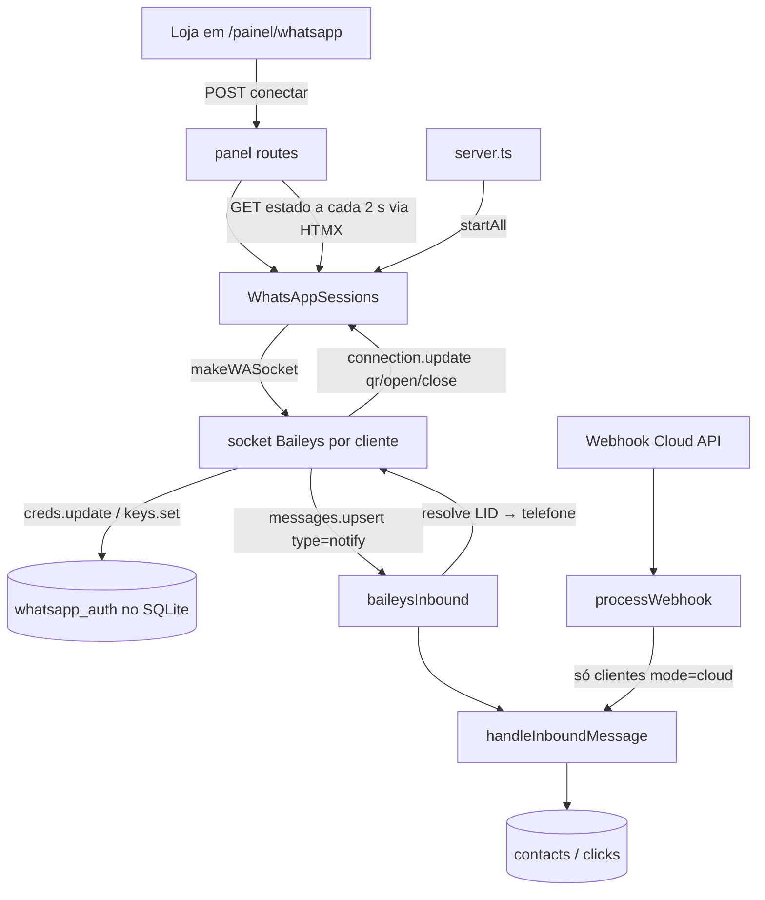
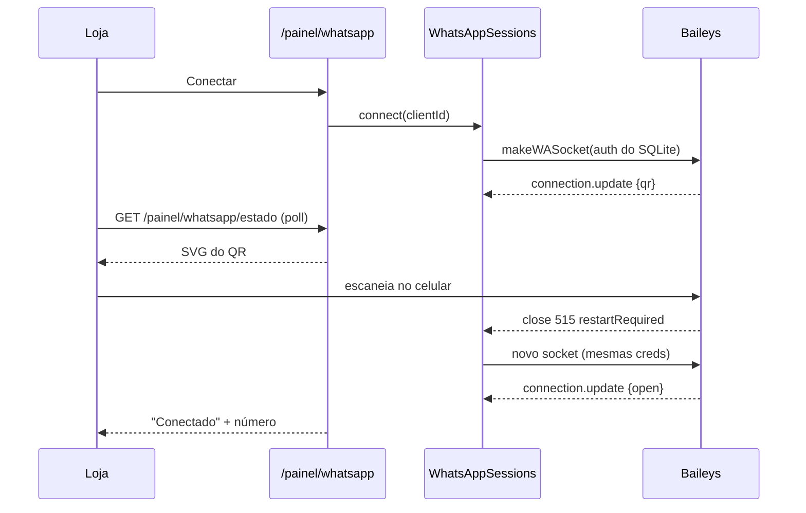

# WhatsApp via Baileys Design

**Spec**: `.specs/features/whatsapp-baileys/spec.md`
**Status**: Approved - 2026-10-31 - user: "aprovo, vai pras tasks"

---

## Approaches

| # | Abordagem | Prós | Contras |
| - | --------- | ---- | ------- |
| **A (recomendada)** | `WhatsAppSessions` dentro do processo do app: um socket Baileys por cliente, estado de autenticação no SQLite | Sem serviço novo, deploy igual ao atual, testes por injeção de um socket falso, cabe em 5 sessões | Um crash do socket roda no mesmo processo (mitigado por try/catch por sessão) |
| B | Worker separado no `docker-compose` rodando o Baileys e chamando o app por HTTP interno | Isola falhas do Baileys | Segundo serviço, segundo processo de SQLite ou API interna, mais código para 1-5 lojas |
| C | Evolution API ou WAHA como container pronto, enviando webhooks ao app | Menos código de Baileys próprio | Mais um serviço com banco próprio (Postgres/Redis na Evolution), webhooks e chave de API para configurar: volta parte da complexidade que queremos tirar |

Recomendo **A**: o volume é de 1 a 5 lojas e o app já é um processo único com SQLite.

---

## Architecture Overview



Sequência de conexão:



---

## Code Reuse Analysis

### Existing Components to Leverage

| Component | Location | How to Use |
| --------- | -------- | ---------- |
| `handleInboundMessage` | `src/services/tracking.ts:86` | Ponto único para as duas fontes; dedup por `(client_id, phone)` já existe |
| `extractRef` | `src/lib/ref.ts` | Achar o ref no texto da mensagem Baileys |
| `requireRole('client')`, `currentClient` | `src/routes/auth.ts`, `src/routes/panel.ts:26` | Rotas de conexão ficam no mesmo plugin do painel, então a loja só vê o próprio cliente |
| `page`, `html` | `src/views/layout.ts`, `src/lib/html.ts` | Tela de conexão |
| HTMX | `public/` | Polling do estado com `hx-get` + `hx-trigger="every 2s"` |
| `createClient` / `updateClient` / CLI | `src/services/accounts.ts`, `src/cli.ts` | Campo `whatsappMode` e flag `--whatsapp-mode` |
| `runBackup` | `src/jobs/backup.ts` | Já copia o SQLite inteiro, então o estado de autenticação entra no backup sem mudança |
| `setup()` | `test/helpers.ts` | Ganha um `sessions` com socket falso |

### Integration Points

| System | Integration Method |
| ------ | ------------------ |
| `buildApp` | Recebe `sessions: WhatsAppSessions` em `AppDeps`; repassa a `panelRoutes` e `adminRoutes` |
| `server.ts` | Cria `WhatsAppSessions` com o socket real, chama `startAll()` depois do `listen`, `stopAll()` no shutdown |
| `processWebhook` | Passa a ignorar clientes com `whatsappMode = 'baileys'` |
| Admin → Sistema | Lê `sessions.status(clientId)` |

---

## Components

### `WhatsAppSessions` (gerenciador)

- **Purpose**: Abrir, manter, reconectar e fechar um socket Baileys por cliente, e expor o estado.
- **Location**: `src/services/whatsappSessions.ts`
- **Interfaces**:
  - `constructor(db: Db, opts: { maxSessions: number; socketFactory: SocketFactory; logger; now?; timers? })`
  - `connect(clientId: number): Promise<void>` lança `SessionLimitError` se `active >= maxSessions` e o cliente não tem sessão
  - `disconnect(clientId: number): Promise<void>` faz `logout()`, apaga `whatsapp_auth` do cliente e marca `desconectado`
  - `status(clientId: number): SessionStatus`
  - `startAll(): Promise<void>` reabre cada cliente `baileys` com `creds.registered`; erro em um não para os outros
  - `stopAll(): Promise<void>` fecha os sockets sem logout
- **Regras de estado** (testadas pelo socket falso):
  - `qr` recebido → `aguardando_qr` com o QR atual (renova a cada novo `qr`).
  - `open` → `conectado`, guarda o número (`sock.user.id`), zera o backoff.
  - `close` com `515 restartRequired` → reabre na hora (fluxo normal pós-scan).
  - `close` com `401 loggedOut` ou `500 badSession` → apaga auth, `desconectado_logout`, sem reconectar.
  - `close` enquanto `aguardando_qr` com timer de 2 min vencido → `qr_expirado`, sem reconectar.
  - Qualquer outro `close` → `reconectando`, nova tentativa após 1, 2, 4… até 60 s.
  - `connect` chamado com sessão já aberta ou abrindo devolve a mesma (um socket por cliente).
- **Dependencies**: `SocketFactory`, `whatsappAuthState`, `baileysInbound`
- **Reuses**: nada direto; isolado para teste.

### `SocketFactory`

- **Purpose**: Única fronteira com o Baileys; os testes trocam por um falso.
- **Location**: `src/services/baileysSocket.ts`
- **Interfaces**: `(auth: AuthenticationState, logger) => Promise<WaSocket>` em que `WaSocket` é o subconjunto usado: `ev.on`, `ev.off`, `end`, `logout`, `user`, `signalRepository.lidMapping.getPNForLID`.
- **Config do socket real**: `version` de `fetchLatestWaWebVersion()` com fallback para a embutida (evita o loop 408 de versão velha, issue aberta), `browser: Browsers.ubuntu('Tracker')`, `syncFullHistory: false` (o `shouldSyncHistoryMessage` padrão fica: desligá-lo tira os mapeamentos LID iniciais), `markOnlineOnConnect: false` (a loja continua recebendo notificações no celular), `keys: makeCacheableSignalKeyStore(...)`, logger pino em `warn`.

### `whatsappAuthState`

- **Purpose**: `AuthenticationState` do Baileys sobre o SQLite, no formato de `useMultiFileAuthState` (lido no pacote) mas em tabela.
- **Location**: `src/services/whatsappAuthState.ts`
- **Interfaces**: `loadAuthState(db, clientId): Promise<{ state: AuthenticationState; saveCreds(): Promise<void> }>`, `clearAuthState(db, clientId)`
- **Regras**: serializa com `BufferJSON.replacer/reviver`; `keys.set` grava em uma transação; JSON inválido em `creds` → trata como sem sessão (edge case de estado corrompido).

### `baileysInbound`

- **Purpose**: Converter `messages.upsert` em `InboundMessage` e chamar `handleInboundMessage`.
- **Location**: `src/services/baileysInbound.ts`
- **Interfaces**: `processUpsert(db, client, upsert, lidLookup, logger): Promise<{ handled: number; skipped: Record<string, number> }>`
- **Regras**:
  - Só `type === 'notify'`; `append` é histórico.
  - Ignora `key.fromMe`, `isJidGroup`, `isJidBroadcast`/`status@broadcast`, newsletter.
  - Telefone: `remoteJid` se `isPnUser`; senão `key.remoteJidAlt` se `isPnUser`; senão `getPNForLID(remoteJid)`; senão pula e loga `warn` com o motivo `lid-sem-telefone`.
  - Texto: `conversation` ?? `extendedTextMessage.text` ?? `buttonsResponseMessage.selectedDisplayText` ?? `listResponseMessage.title` ?? `''`, só para `extractRef`, nunca guardado.
  - `timestamp`: `messageTimestamp * 1000`, fallback `now`. `name`: `pushName` cortado em 120.
- **Reuses**: `extractRef`, `handleInboundMessage`.

### Rotas e telas

- `GET /painel/whatsapp`: página de conexão (link no menu do painel).
- `POST /painel/whatsapp/conectar` e `POST /painel/whatsapp/desconectar`.
- `GET /painel/whatsapp/estado`: fragmento HTMX; com QR, renderiza SVG inline gerado no servidor por `qrcode.toString(qr, { type: 'svg' })` (a CSP já permite SVG inline como markup, sem script).
- Cliente em modo `cloud`: a página diz "Este cliente usa a Cloud API" e não mostra o botão.
- Admin → Sistema: bloco "WhatsApp" mostra o modo e, em `baileys`, o estado e o número de cada cliente, mais o botão "Desconectar".

---

## Data Models

```typescript
// clients: nova coluna
whatsappMode: text('whatsapp_mode', { enum: ['baileys', 'cloud'] }).notNull().default('baileys')

// nova tabela
export const whatsappAuth = sqliteTable('whatsapp_auth', {
  clientId: integer('client_id').notNull().references(() => clients.id, { onDelete: 'cascade' }),
  key: text('key').notNull(),          // 'creds' ou '<type>-<id>'
  value: text('value').notNull(),      // JSON com BufferJSON
  updatedAt: integer('updated_at').notNull(),
}, (t) => [primaryKey({ columns: [t.clientId, t.key] })]);

type SessionStatus =
  | { state: 'desconectado' }
  | { state: 'conectando' }
  | { state: 'aguardando_qr'; qr: string }
  | { state: 'qr_expirado' }
  | { state: 'conectado'; phone: string }
  | { state: 'reconectando'; attempt: number }
  | { state: 'desconectado_logout' };
```

**Migração** `0001_whatsapp_baileys.sql` (gerada pelo `drizzle-kit generate`): adiciona a coluna com default `baileys` e faz `UPDATE clients SET whatsapp_mode = 'cloud' WHERE whatsapp_phone_number_id IS NOT NULL`, como a spec pede.

---

## Error Handling Strategy

| Error Scenario | Handling | User Impact |
| -------------- | -------- | ----------- |
| Limite de 5 sessões | `SessionLimitError` na rota | "Limite de conexões atingido" |
| Queda de rede | Backoff 1 s até 60 s | Painel mostra "Reconectando…" |
| Aparelho removido no celular | Apaga auth, sem reconectar | "Desconectado, escaneie o QR code" |
| QR não escaneado em 2 min | Fecha o socket | "QR expirado" + "Gerar novo QR" |
| Exceção dentro de `processUpsert` | `try/catch` por mensagem, `log.error`, segue para a próxima | Nenhum; aquela mensagem não vira contato |
| Falha ao reabrir sessão no boot | `log.error`, estado `reconectando` | App sobe normal |
| `fetchLatestWaWebVersion` falha | Usa a versão embutida | Nenhum |

---

## Risks & Concerns

| Concern | Location (file:line) | Impact | Mitigation |
| ------- | -------------------- | ------ | ---------- |
| Baileys é RC (7.0.0-rc14) e não-oficial; o WhatsApp pode mudar o protocolo | `package.json` | Sessões caem até atualizar a lib | Versão exata fixada; tudo atrás do `SocketFactory`; a Cloud API continua pronta como saída |
| Banimento do número da loja | - | A loja perde o WhatsApp do número | Aceito pelo usuário; o socket não envia mensagens e não marca online |
| `libsignal` é GPL-3.0 (dependência do Baileys, que é MIT) | `node_modules/libsignal` | Obrigação de licença se o software for distribuído | O app roda só na sua VPS (não é distribuído); registrar no README. Uma revisão jurídica fica com você |
| LID: no Baileys 7 o remetente pode chegar só como `@lid` | `src/services/baileysInbound.ts` | Contato perdido se não houver telefone | Três fontes em ordem (`remoteJid`, `remoteJidAlt`, `getPNForLID`); o log conta os `lid-sem-telefone`; confirmar no teste real com a loja |
| Estado de autenticação é segredo de sessão do WhatsApp | tabela `whatsapp_auth`, backups | Quem tiver o backup pode se passar pelo aparelho | Mesmo nível do banco atual; o backup externo já depende do seu rclone. Deixar isso claro no README |
| `processWebhook` busca cliente por `phone_number_id` sem olhar o modo | `src/services/whatsapp.ts:59` | Cliente `baileys` com PNID antigo receberia pelos dois caminhos | Filtro por `whatsappMode = 'cloud'` (WA-04) |
| Testes atuais criam o cliente com PNID e postam webhook | `test/helpers.ts:25` | Com o novo default, os testes de webhook mudariam de caminho | `setup()` cria o cliente de teste com `whatsappMode: 'cloud'`; os testes novos criam um cliente `baileys` |
| Socket roda no mesmo processo do HTTP | `src/server.ts` | Exceção não tratada derruba o app | Handlers dentro de `try/catch`; `ev` só chama funções que capturam |

---

## Tech Decisions

| Decision | Choice | Rationale |
| -------- | ------ | --------- |
| Pacote | `baileys@7.0.0-rc14` exato (o nome novo no npm; `@whiskeysockets/baileys` é o mesmo projeto) | `latest` no npm; fixar evita uma RC nova entrar sozinha |
| QR | `qrcode@1.5.4` → SVG no servidor | Sem script novo no navegador; respeita a CSP atual |
| Atualização da tela | Polling HTMX a cada 2 s, só enquanto a página de conexão está aberta | HTMX já está no projeto; SSE seria mais código para 1-5 lojas |
| Histórico | `syncFullHistory: false`, sync padrão do Baileys mantido, e só `messages.upsert` tipo `notify` é tratado | Spec: não processar conversas anteriores; a lib avisa que desligar todo o sync quebra o mapeamento LID |
| Online | `markOnlineOnConnect: false` | A loja continua recebendo notificações no celular |

AD-001 em `.specs/STATE.md`: "Toda fonte de mensagens do WhatsApp entra por `handleInboundMessage`; o modo por cliente (`clients.whatsapp_mode`) escolhe a fonte."
